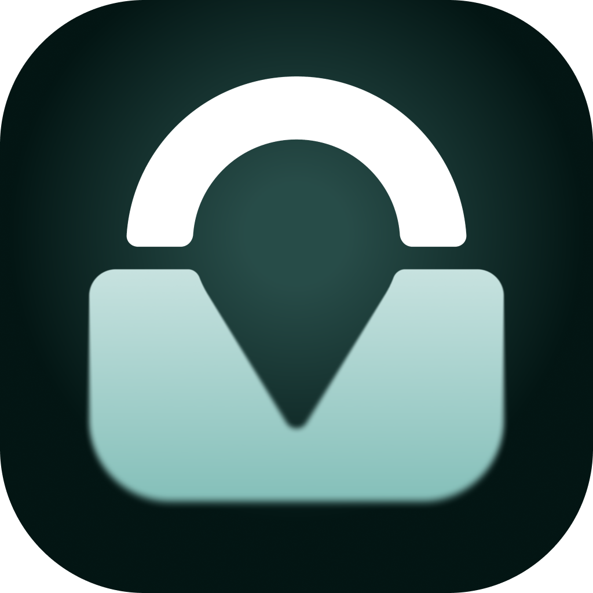
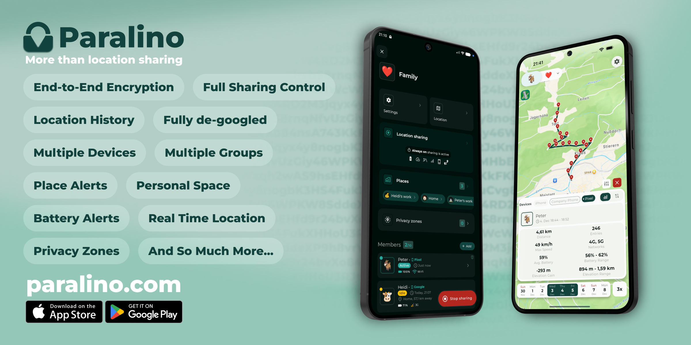

<p align="center">
  
</p>

<h1 align="center">Paralino - More than Location Sharing</h1>

<p align="center">
  
</p>

<p align="center">
<a href="https://paralino.com/">Website</a> | <a href="https://paralino.com/download">Download</a> | <a href="https://paralino.com/help">Docs</a> | <a href="https://portal.paralino.com/roadmap">Roadmap</a> | <a href="https://portal.paralino.com/changelog">Changelog</a>
</p>

Paralino is an end-to-end encrypted, privacy-focused, real-time location sharing and family safety app for Android and iOS.

Don't want to share with others? Use it for yourself in your personal space to track your own devices and record your own location history.

## What Paralino offers

### Groups & devices

- **[Real-time location](https://paralino.com/help/location-sharing/how-location-updates-work)**: continuous location updates with live device movement tracking.
- **[Location history](https://paralino.com/help/location-history/introduction)**: track your own location history or share it with others. Use it to review your trips and recall specific moments in time.
- **[Private groups](https://paralino.com/help/groups/create-join-group)**: create private groups for your family and friends to granularly control sharing in different social contexts.
- **[Personal space](https://paralino.com/help/personal-space/introduction)**: a dedicated section in the app only for you and your devices. Use it to find your own devices, track your trips, review your own location history and more.
- **Device status monitoring**: check speed, elevation, battery level, signal strength, etc. in real-time directly on the map.
- **Multiple devices**: connect multiple devices like phones and tablets to the same account and share your location seamlessly from all of them.

### Control & alerts

- **[Full sharing control](https://paralino.com/help/location-sharing/sharing-data)**: you choose what, when, and with whom to share. Don't share battery level, skip including your speed, share only for 2 hours, only share approximate location, and many more granular controls.
- **[Privacy zones](https://paralino.com/help/privacy-zones/introduction)**: create special areas on the map which will obscure your actual location and automatically switch to approximate sharing when you enter them.
- **[Place alerts](https://paralino.com/help/places/place-notifications)**: create geofences and get alerts when someone from your group enters or leaves a specific place like home, work, school, etc.
- **[Low battery alerts](https://paralino.com/help/location-sharing/battery-notifications)**: get alerts when someone's device is running low on battery.
- **[Proper battery optimization](https://paralino.com/help/location-sharing/location-settings/)**: you control how hard you want Paralino to work in the background. Pick your performance profile and the app will do the rest.
- **Rich push notifications**: get alerts when someone joins a group, starts sharing their location, has low battery, enters a predefined place, etc.

### Privacy & trust

- **[End-to-end encryption](https://paralino.com/architecture)**: your location and all related data are encrypted end-to-end, never leave your device in plain text, and only you and your family's devices can decrypt it.
- **[Fully de-googled Android](https://paralino.com/help/general/de-googled-android-app)**: the dedicated APK edition contains no Google services, uses MapLibre for maps, [UnifiedPush](https://unifiedpush.org/) or direct WebSocket connections for push notifications, and native AOSP LocationManager for location tracking. Built-in app updates without the need for manual downloads when new versions are released.
- **EU-based 🇪🇺**: built and hosted in the European Union.
- **No ads, no tracking, no data selling**: your data stays yours.

## E2EE

To check out how Paralino implements end-to-end encryption, please visit the [Architecture](https://paralino.com/architecture) page.

## Download

- iOS ([App Store](https://apps.apple.com/app/id6736908747))
- Android with Google Maps ([Google Play](https://play.google.com/store/apps/details?id=app.paralino.android))

### Android de-googled APK

You can download the de-googled APK from the [Download](https://paralino.com/download) page, or directly from the [GitHub Releases](https://github.com/paralino/paralino/releases).

Use this command to verify the signature of the APK:
```bash
apksigner verify -v --print-certs --min-sdk-version 29 ParalinoAndroidDirect.apk
```

**SHA-256** signing certificate hash:
```
7C:36:87:CA:81:BC:A2:0C:32:09:5E:CE:AD:18:29:09:DC:50:87:03:6A:37:F0:77:2B:2D:9E:5D:85:91:41:DC
```

## Modules & Architecture

The project is structured as a modular Kotlin Multiplatform repository to maximize code reuse across Android and iOS. Besides business logic, the vast majority of the UI is also shared between the two platforms by Compose Multiplatform.

* **`androidApp`**: Android-specific module containing platform-specific implementations and build definitions.
* **`iosApp`**: Xcode project containing a native iOS application based on Swift/SwiftUI and wrappers for Compose components.
* **`shared`**: The central library linking the common KMP core directly into both the Android app and the iOS framework.
* **`core-*`**: Shared core libraries containing general utilities, business logic, models, resources, UI components, etc.

## Building & Running

Before building Paralino locally, ensure you have the following IDEs installed on your system:

- **Android Studio** (Quail 2026.1.1 or newer)
- **Xcode** (26.5 or newer, required for iOS and running on macOS 26.5 or newer)

### Clone the Repository Recursively
Paralino utilizes several Git submodules, so clone the project recursively:

```bash
git clone --recursive https://github.com/paralino/paralino.git
```

### Running the Android Application
To build and install the application onto an active Android emulator or physical device, either tap on the **Run** button in Android Studio or run the following command in the terminal:

```bash
./gradlew :androidApp:installDirectReleaseLocal
```

The **directReleaseLocal** build type is already configured to use your local keystore and requires zero project setup or configuration in order to have an optimized, locally built, fully functional APK installed on your device. Besides using your local keystore, there is no difference between _directReleaseLocal_ and the officially distributed de-googled APK.

### iOS Application
You can also run the iOS application directly through Xcode, but certain features like push notifications and background location tracking will not work since those are only available on approved production builds.

## Contributing

Bug reports, feature ideas, and general feedback are very welcome.
You can help by opening issues, sharing thoughts on [GitHub Discussions](https://github.com/paralino/paralino/discussions), or using our [feedback portal](https://portal.paralino.com).

See [CONTRIBUTING](CONTRIBUTING.md) for details on how to report bugs, suggest enhancements, and get in touch.

Paralino Android and iOS apps are open-source for the purpose of providing trust and transparency into the inner workings of the project.
Considering that and due to a tightly planned [roadmap](https://portal.paralino.com/roadmap), external code contributions via pull requests are not enabled at this stage.

## License

This project is licensed under the **[GNU Affero General Public License v3 (AGPL-3.0)](https://www.gnu.org/licenses/agpl-3.0.html)**.

Google Play and the Google Play logo are trademarks of Google LLC. Apple, the Apple logo, and other Apple trademarks are trademarks of Apple Inc.
